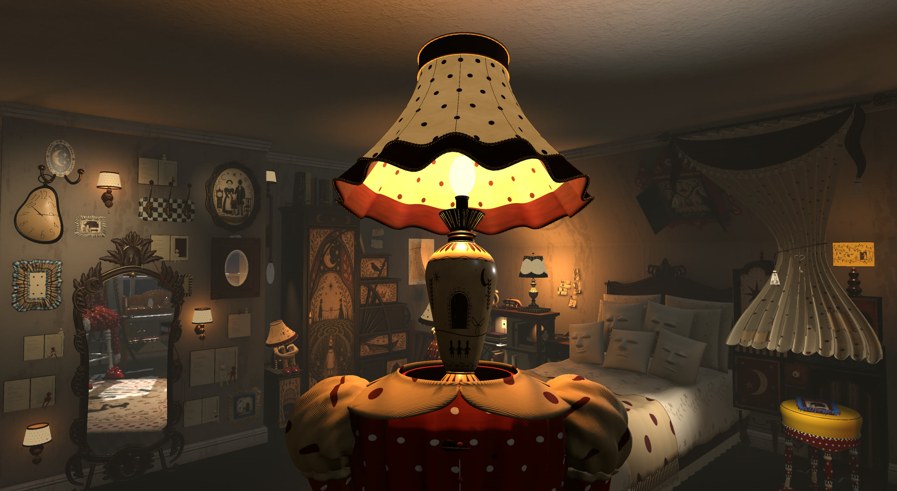

# The Room Knows My Childhood Name
# 房间记得我童年的名字

**版权与使用：** 本项目未提供仓库级开源许可。允许阅读与分享官方链接；转载、重新分发或素材复用须遵循[版权与使用说明](COPYRIGHT.md)。第三方许可、法律允许的使用与 GitHub 平台功能另行适用。

这是我围绕童年记忆与自我安慰创作的一款第一人称叙事游戏。玩家在一间卧室中观察物件、聆听记忆并回应房间，经历六个阶段的情绪变化。

A first-person narrative game about exploring a childhood bedroom, listening to memories and responding to the room.

## 试玩 / Play

**有兴趣尝试离线试玩版本和 API 联网版本，请联系作者：[zhiruizh2025@163.com](mailto:zhiruizh2025@163.com)**，也可以在[仓库 Issue](https://github.com/yuechen676-hub/The-Room-Knows-My-Childhood-Name/issues) 留言。试玩版目前不公开下载。

**Interested in trying the offline demo or the live API version? Please contact the author at [zhiruizh2025@163.com](mailto:zhiruizh2025@163.com)** or open an [Issue](https://github.com/yuechen676-hub/The-Room-Knows-My-Childhood-Name/issues). The demo is not publicly downloadable at the moment.

- **离线试玩版：** Windows 64 位，无需 Unity、Python、网络或 API Key。采用**可选台词与预录模型文字回复**，保留场景探索、线索录音、六阶段流程及结尾；不支持自由输入。中文 / English、阅读字号可在设置中切换，物件录音保留中文原声。
- **API 联网版：** 支持自由输入，由 Python 服务调用语言模型实时回应，并结合阶段规则判断推进。系统设计见[联网模式说明](docs/LIVE-DIALOGUE.md)。

- **Offline demo:** Windows 64-bit; selectable lines with prerecorded model text, including the six-stage progression and ending. No internet connection or API key required.
- **Live API version:** free-form dialogue through a Python service and a language model, with stage rules governing progression.

## 操作 / Controls

| 输入 / Input | 功能 / Action |
|---|---|
| WASD / 鼠标 | 移动 / 观察 · Move / look |
| 左键 / Left click | 交互 / 选择 · Interact / select |
| 查看时按住右键 / Hold right mouse in inspection | 旋转物件 · Rotate object |
| Ctrl / C | 蹲下 · Crouch |
| Space | 站立时跳跃 · Jump while standing |
| Enter | 打开房间对话 · Open room dialogue |
| Esc | 关闭当前界面或暂停 · Close / pause |

先探索并聆听当前阶段的录音，再与房间交谈。读完回复后关闭对话，阶段变化才会继续。找不到方向时可选择房间对话中的引导选项。

## 技术文档 / Documentation

**[游戏开发文档：玩法、系统实现与技术迭代](docs/README.md)**

- [六阶段程序化天空](docs/SKY.md) · [四种交互着色器](docs/SHADERS.md)
- [资产预算与程序化外壳](docs/TOOLS.md) · [性能分析与优化](docs/PERFORMANCE.md)
- [交互、声音与界面](docs/INTERACTION.md) · [AI 叙事迭代](docs/NARRATIVE.md)
- [制作与 AIGC 辅助流程](docs/PRODUCTION.md) · [开发迭代与后续计划](docs/REVIEW.md)

- [技术总览与模块架构](docs/TECHNICAL.md)
- [离线数据、推进与实时接口](docs/DIALOGUE.md)（含实现细节及轻度剧透）
- [构建、运行与发布](docs/BUILD.md)
- [测试结果与已知限制](docs/VALIDATION.md)

本仓库用于技术说明与效果展示，只包含文档和图例，不是完整 Unity 工程，也不提供试玩下载。

文档介绍开发工程中的实现；完整 Unity 工程、试玩构建及原始制作素材未公开。试玩版本请联系作者获取。

## 制作与工具 / Credits

Unity / C# 实现探索、物件查看、声音、界面和阶段表现；Blender 与制作脚本用于资产整合，房间外壳和天空采用程序化实现。Python / Flask / Anthropic SDK 支持可选联网对话。孩子声音使用 ElevenLabs 预先制作，开发包含 AI 编程辅助和少量 AIGC 辅助贴图产出。详见[资产制作与场景整合](docs/PRODUCTION.md)。
