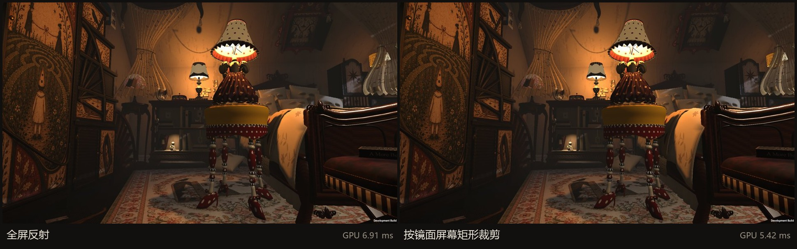
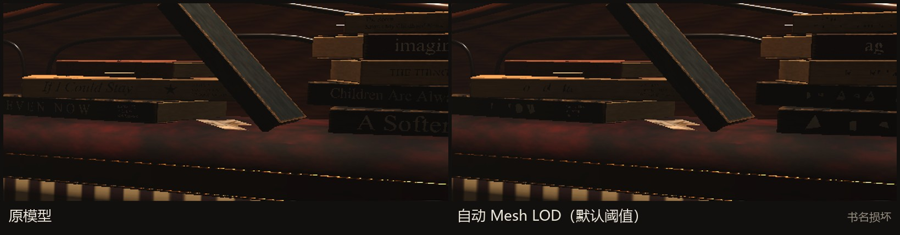

# 案例四：先测量，再优化

[文档目录](README.md)

## 优化目标与测量方法

我优先检查重复绘制与交互长帧：前者影响持续帧率，后者会打断观察和阶段过渡。测试使用 Windows Development Player、Direct3D12、1920×1080，关闭 VSync、不限帧；硬件为 i5-13600KF / Radeon RX 6750 GRE 12GB，约 32GB RAM。

探针从固定起点水平旋转 360°，预热后逐帧采样 FPS、CPU/GPU 时间、P95、批次、三角形及 GC。候选方案在同一进程内交替开启，首尾基线检查漂移。交互诊断另包含查看与阶段切换路线。测量时关闭远程 AI，将采样范围限定为客户端渲染和交互开销。

9 月 30 日使用 3 秒预热、12 秒采样；10 月 5 日候选方案使用 2 秒预热、8 秒采样。10 月 7 日标题菜单与出生视角变化，因此不能把跨轮结果当成严格控制变量实验。

[探针源码](evidence/source/RoomPerformanceProbe.cs) · [10 月 5 日原始数据](evidence/gpu-baseline.json)

## 发现：多次渲染放大了几何成本

| 10 月 5 日同轮配置 | FPS | GPU ms | 批次 | 三角形 |
|---|---:|---:|---:|---:|
| 当时基线 | 117.7 | 6.90 | 4,545 | 2,448 万 |
| 关闭三面镜子 | 173.5 | 4.78 | 2,655 | 1,472 万 |
| 关闭点光 / 聚光阴影 | 154.2 | 5.48 | 3,307 | 1,611 万 |
| 镜子与全部阴影关闭 | 290.0 | 2.85 | 750 | 350 万 |

约 `1 − 350 / 2448 ≈ 85.7%` 的测得几何绘制量来自额外镜面与阴影 Pass。这是几何计数的拆解，**不是 85% GPU 时间**。不同开关的收益有交互，不能简单相加。最终方案保留镜子和必要阴影。

## 镜面视锥裁剪

旧实现按完整视锥绘制反射，即使镜子只占屏幕一小块。新实现把镜面 bounds 的八个角投影到 viewport，得到可见矩形并加两像素余量，再用裁剪矩阵重映射反射投影。

RenderTexture 按对应矩形分配，保持原像素密度，以 32 像素分桶减少尺寸抖动，使用临时 RT 池。镜面 Shader 继续通过 `_ReflectionVP` 采样。若角点落在近裁剪面之后，保守回退完整视口，避免不稳定的投影矩形裁掉反射。

| 10 月 5 日同进程两轮均值 | 全屏反射 | 裁剪后 |
|---|---:|---:|
| FPS | 124.7 | 157.2 |
| GPU 时间 | 6.91 ms | 5.42 ms |
| P95 帧耗时 | 11.25 ms | 8.00 ms |
| 批次 | 4,590 | 3,359 |
| 三角形 | 2,470 万 | 1,820 万 |

这轮实验中，GPU 时间约下降 22%，P95 约下降 29%。同期四方向截图检查发现差异集中在镜内边缘。以上结果对应 10 月 5 日的实验构建。

[裁剪实现](evidence/source/PlanarReflectionScissor.cs) · [候选原始数据](evidence/mirror-candidates.json)

## 阶段卡顿：音频，而非 DX12 预热

阶段变化后约 2.7 秒反复出现长帧。定位时把时序拆开：面板关闭约 0.5 秒、等待 0.6 秒、环境音淡出 1.5 秒，然后首次播放下一段环境音。

六段环境音原为加载时解压且不预加载，首次播放时发生同步解码。改为 Streaming 后，历史交互复测记录如下：

| 采样段最长帧 | 改前两轮 ms | 改后两轮 ms |
|---|---:|---:|
| 2 → 3 | 91.8 / 83.4 | 13.7 / 10.0 |
| 3 → 4 | 85.3 / 86.1 | 13.2 / 10.9 |
| 4 → 5 | 78.4 / 77.3 | 13.1 / 10.3 |
| 5 → 6 | 83.2 / 83.9 | 9.5 / 10.5 |
| 全程 >80 ms 帧数 | 5 / 4 | 0 / 0 |

1 → 2 多了一段灯光过渡，导致长帧落进随后马克杯查看采样段；因此旧记录中的“马克杯卡顿”被重新归因。当前 stage1–6 音频导入配置仍为 Streaming。改前后是不同构建，期间视角也改变；时序与复现位置支持音频归因，但不能把全部帧率差异都归给音频。

## 被否定或撤回的方案

| 尝试 | 证据 | 处理 |
|---|---|---|
| DX12 状态预热 | 四轮对照没有稳定收益，后续不预热轮也接近预热轮 | 未采用 |
| 自动 Mesh LOD | 默认阈值即破坏书脊文字；保护细碎网格后只剩约 3% 减面 | 撤回 |
| 小于 20 cm 的物件取消投影 | 投影物体少 670，但时间变化在噪声范围内 | 未采用 |
| 局部阴影降至 Low | 图集降分辨率警告减少，性能无可测变化 | 作为阴影预算调整采用，未测得帧率提升 |
| 主光改为单级级联 | 历史测试有约 0.4 ms 收益但画面更软 | 实验结论待定，尚未确认采用 |

整图差异和分块差异未自动识别这处小面积暗字损坏。文字相关优化需要内容可读性检查。

## 不同开发阶段的测量结果

9 月 30 日初始基线为 75.9 FPS / P95 19.79 ms；10 月 5 日镜面裁剪结果为 157.2 FPS / P95 8.00 ms。两次测量之间的场景状态和采样设置发生过变化，因此我用它们记录开发进展，单项优化收益则采用同轮对照。

镜面裁剪的同轮对照为 **124.7 → 157.2 FPS，GPU 6.91 → 5.42 ms**。发布试玩包尚未重复这套性能采样；不同硬件的实际帧率仍需单独测试。

## 未解决的测量问题

10 月 7 日记录仍有铁罐查看时周期性长帧、行走时偶发长帧与出生朝向绘制量偏高。部分非环境音首次播放也可能有开销。后续应以最新构建、固定交互脚本、可见窗口重新验证，再决定是否优化。阶段音频问题得到改善后，其他交互长帧仍需分别定位。

原始报告：[9 月 30 日](evidence/performance-20260930.md) · [10 月 5 日](evidence/performance-20261005.md) · [10 月 7 日](evidence/performance-20261007.md)

