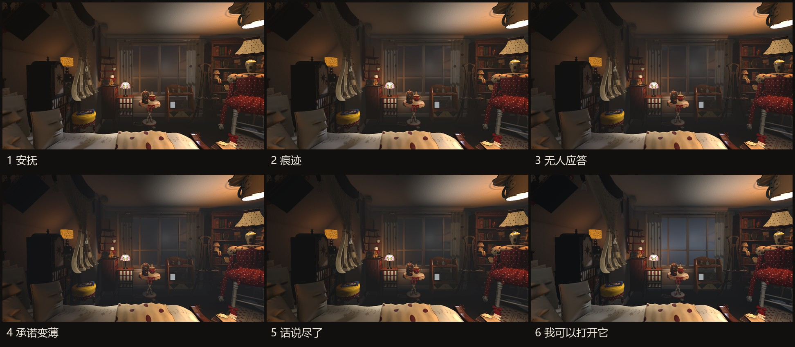

# 游戏开发文档 · 从玩法到系统实现

[项目首页与试玩](../README.md)

这份文档记录我开发《The Room Knows My Childhood Name》的过程：如何把探索和对话组织成玩法，如何用视听变化表达阶段情绪，以及如何解决交互与性能问题。内容从玩家的探索与表达出发，展开交互、叙事状态、视听表现、资产制作和性能优化。我也记录了机器学习分类器、自动 LOD 等尝试，包括实验结果、遇到的问题和最终取舍。建议先阅读技术总览，再根据兴趣进入具体系统。

六阶段空间表现对比，制作于 2026-10。

## 阅读路线

| 想了解什么 | 章节 |
|---|---|
| 整体技术栈与模块关系 | [技术总览](TECHNICAL.md) |
| 一个天空如何表达六阶段情绪 | [案例一：程序化天空与预览工具](SKY.md) |
| 凝雾、睁眼、描边、纸背墨迹 | [案例二：交互着色器](SHADERS.md) |
| 如何定位重资产、重建房间外壳 | [案例三：资产预算与程序化制作](TOOLS.md) |
| 镜面优化、音频卡顿与失败方案 | [案例四：性能分析与优化](PERFORMANCE.md) |
| 拿起、翻看、记录、字幕与转场 | [交互、声音与界面](INTERACTION.md) |
| 自由输入如何受叙事规则约束 | [AI 叙事系统与分类器迭代](NARRATIVE.md) |
| 离线 77 个回复变体如何回放 | [对话数据与接口](DIALOGUE.md) |
| 使用自己的 API Key 开启联网对话 | [联网安装、Key 输入与切回离线](LIVE-DIALOGUE.md) |
| 资产整合与简要 AIGC 流程 | [资产制作与场景整合](PRODUCTION.md) |
| 如何构建、打包、校验和运行 | [构建与发布](BUILD.md) |
| 测试方法、结果与待验证项 | [验证报告](VALIDATION.md) |
| 哪些方案被采用、调整或撤回 | [开发迭代与后续计划](REVIEW.md) |
| 原始数字与可阅读的代码 | [实现与测试资料](evidence/README.md) |

## 项目范围

运行时采用 Unity / C#；实时对话通过 Python 服务接入语言模型。离线试玩将实时服务替换为预录回复，但仍由玩家探索和选择推动六阶段流程。实时模型不生成三维场景，也不在运行时生成贴图或逐句合成语音。

技术实现的共同约束是信息出现的时机：材质效果、音频、物件记录和对话都必须对应玩家实际听见、看见的内容。结尾由玩家主动完成，不能以服务端的一项完成标志直接代替开门和跨门槛动作。

## 测试与实现资料

[验证报告](VALIDATION.md)集中说明测试方法、通过结果和待完成的试玩检查；[实现资料索引](evidence/README.md)提供代码摘录与开发测量记录。性能数据保留版本、日期和采样条件，便于理解优化前后的差异。

`docs/evidence/source/` 提供 18 份讲解用代码快照，缺少完整依赖与资产，不能独立构建游戏。当前试玩使用的构建日期见[发布说明](BUILD.md)。
