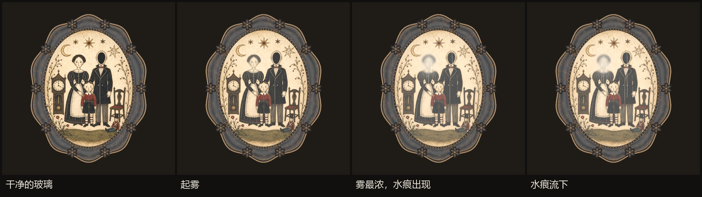
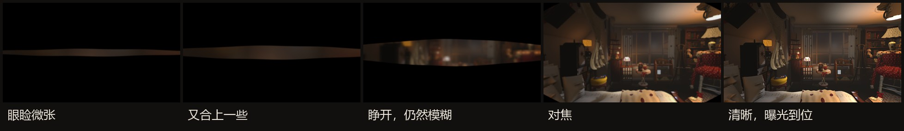
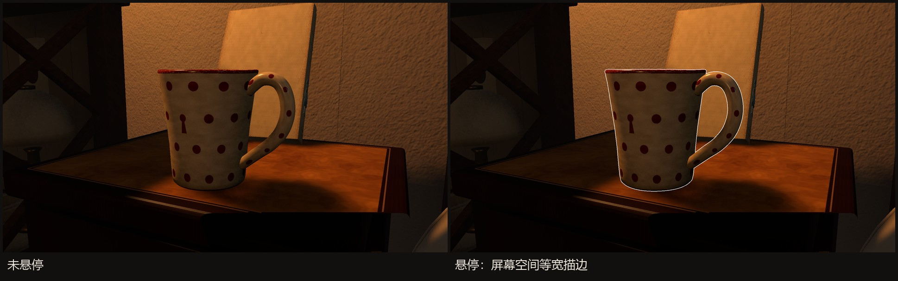
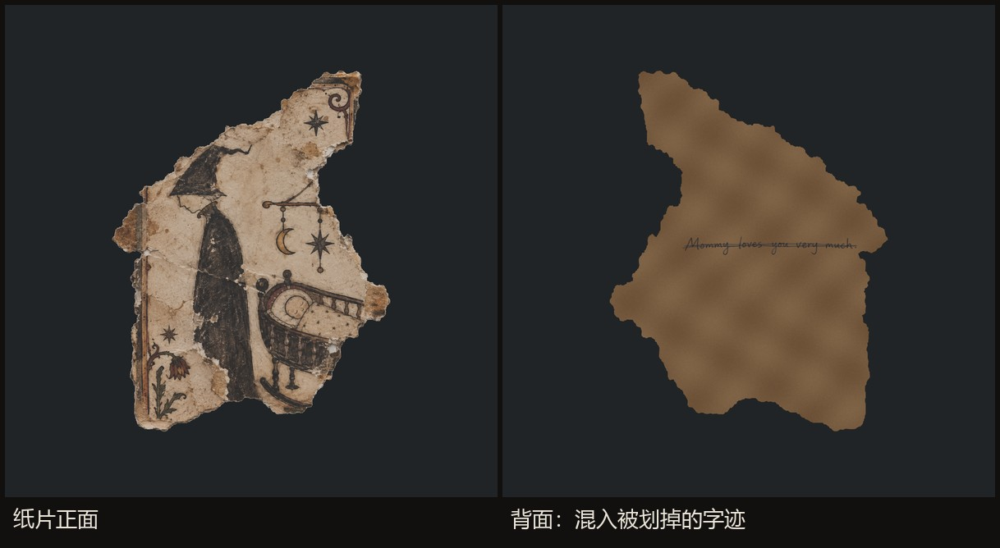

# 案例二：四种交互着色器

[文档目录](README.md) · 材质表现与观察动作

我围绕观察动作制作了四种着色器效果，分别用于物件表面、开场与交互轮廓。相框凝雾和纸背墨迹扩展 URP Lit 的材质输入，复用其光照与阴影，让效果与房间中的其他材质保持一致。

## 1. 相框凝雾：局部模糊与水痕

先调用原始 Lit 表面初始化，再修改 albedo 和 smoothness。脸部附近用椭圆形衰减得到雾气分布；对底图作 12 个分布采样以产生局部模糊，混入偏暖灰的雾色。三条水痕由固定横向位置、轻微正弦弯曲和随进度下降的头部位置构成，痕迹处重新混入较清晰的底图并增加窄高光。

控制脚本将总进度映射到两个参数：Mist 在前 65% 内逐步建立，Rain 在 42% 后开始。播放录音时用其时长决定持续时间；提前停止录音会停止更新。效果只改画芯材质，不让人物或相框自行变形。

这里采用可控的表面遮罩与采样，便于按录音时长编排效果，无需流体模拟。水痕呈现房间对照片的掩饰，保留说辞与现实之间的不确定性。

[材质输入扩展](evidence/source/PortraitCondensationInput.hlsl) · [进度控制](evidence/source/PortraitCondensation.cs)

## 2. 睁眼：实时画面、眼睑遮罩与聚焦

WakeUpEyes 接收实时房间画面。片元根据水平位置计算眼睑开口：中心高、两侧收窄，再以 smoothstep 软化边缘。开口之外输出黑色；开口之内用 3×3 加权采样、mip 层级与 exposure 表现从模糊到聚焦的过程。

关键参数是 `_Open`、`_Blur`、`_Exposure`。几何开口与光适应分开，便于调节睁眼速度而不同时改变亮度曲线。效果直接合成实时场景，因此睁眼后能自然接入玩家当前所在的房间。

[着色器快照](evidence/source/WakeUpEyes.shader)

## 3. 悬停描边：控制像素宽度

目标先参与遮罩，再绘制向外扩张的背面。描边 Pass 使用 Cull Front、ZTest LEqual 与 stencil bit 64 的 NotEqual 比较，使扩张部分主要出现在轮廓外侧。

顶点将法线方向投影到屏幕，以屏幕尺寸归一化后移动裁剪空间位置；当前实现约为 2 像素宽，而不是统一放大模型。这样远近变化时轮廓宽度更稳定。该算法仍依赖网格法线与拓扑，复杂交叠、细碎几何和极端角度需视觉检查。

描边表示“这里可交互”，不表示物件必然是当前阶段线索。

[描边 Pass](evidence/source/OutlineEdge.shader)

## 4. 纸背墨迹：复用纸张光照

纸背材质复用 Lit 表面数据。根据 `_InkRect` 将反转后的 U 坐标映射到手写图的矩形范围，以边界遮罩限制贴图作用区，再按图像 alpha 混入原纸张 albedo。保留原有法线、光照和阴影。

我将墨迹呈现与发现判定分开：着色器负责画出文字，观察代码检查翻转和可见条件，再写入 discoveries。这样只有玩家实际看见的细节才会进入对话上下文。

[墨迹输入扩展](evidence/source/PaperReverseInput.hlsl)

## 视觉检查方法

检查原始材质、效果中间态和完成态；同时检查正面、背面、近看与返回场景。对线索文字必须人工确认可读性，不能只用整图像素差异判断。性能成本也应按实际触发频率区分：常驻轮廓检测、一次性开场与短时凝雾不是同一种负载。

