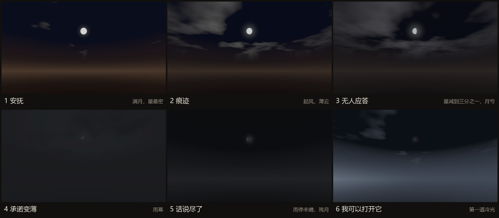
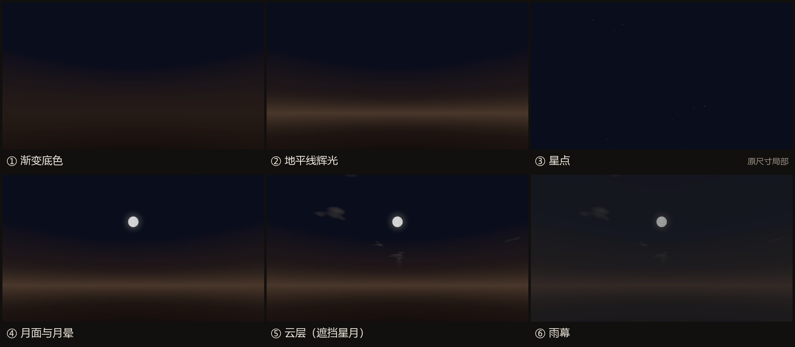

# 案例一：一个房间，六个天空

[文档目录](README.md) · Shader / Runtime Controller / Editor Tool

## 问题与选择

六个阶段需要连续改变同一间卧室的情绪。换六张天空贴图不易同时协调星点、月相、云层、雾和室内环境光，因此我选择用一套参数控制天空，并将阶段外观保存为预设。

运行时由一个程序化天空 Shader、六个 StageSkyPreset 资源和一个 SkyAtmosphereController 共同完成。天空 Shader 根据视线方向与噪声函数生成外观，无需采样天空贴图。

六组预设服务于从愿意相信、怀疑、孤独到停止自欺的渐进变化。图中名称是制作时使用的预设简写。

## 从视线方向生成天空

顶点阶段输出世界方向，片元阶段归一化为方向向量。按以下顺序叠加：

| 层 | 实现 | 美术控制 |
|---|---|---|
| 天地渐变 | 用方向 y 值相对地平线做混合 | 地平线、天顶、地面颜色和衰减 |
| 地平线微光 | 高度带与方位点积共同加权 | 暖意范围、强度与朝向 |
| 星点 | 单位球方向映射三维格点，hash 决定存在和偏移 | 密度、亮度、大小与闪烁 |
| 月亮 | 方向点积与月面局部坐标计算盘面、明暗和细节 | 方位、高度、月相和光晕 |
| 云 | 四层 value-noise fBm 及时间偏移 | 覆盖率、软度、漂移和受光 |
| 雨幕 | 对已经合成的天空做颜色覆盖 | 雨量与颜色 |

云在星月之后合成，因此可以遮住星点和月亮。星点亮度变化与星点是否存在分别控制，避免密度参数只把所有星点一起变暗。当前云层使用四层 fBm，限制噪声叠加的复杂度；各层独立的 GPU 成本尚未测量。

[天空 Shader 快照](evidence/source/RoomProceduralSky.shader)

## 阶段参数与过渡

StageSkyPreset 保存阶段编号、意图说明、过渡时长和 SkySettings。后者还包括 ambient、fog、key light、light shaft 与部分后处理参数。控制器显式更新环境光：天空的颜色改变不意味着室内就自动获得相应光照。

过渡使用 unscaledDeltaTime 累积时间，经过 SmoothStep 后混合参数。颜色用 Color.Lerp，角度用 LerpAngle，避免月亮在 359° → 1° 时绕远路。第一阶段没有前态，直接应用；收到新的合法阶段时停止旧协程，并从当时的 current 状态继续混合。

材质运行时克隆，避免把播放期间的参数写回原始资源。月光只在找到唯一方向光或显式引用时接管；多个方向光时不随意选择。

[预设与插值](evidence/source/StageSkyPreset.cs) · [运行时控制器](evidence/source/SkyAtmosphereController.cs)

## 预览工具为什么是实现的一部分

`Tools > Room > Sky > Stage Preview` 可在编辑器中选择两个阶段并拖动混合进度。它与运行时共用参数应用函数，让制作时看到的效果尽量对应游戏中的结果。

工具保存当前天空、环境光、雾与灯光状态，使用临时材质预览，关闭时恢复；将效果写入场景是独立操作。这样可以检查“第 2 阶段过渡到第 3 阶段中间是否突变”，无需每次从头通关。

[预览窗口快照](evidence/source/SkyStagePreviewWindow.cs)

## 与叙事节奏衔接

我将天空切换放在玩家读完并关闭收束回复之后，让环境变化成为对这次交流的反馈。第六阶段保留克制的视觉表达：离开是玩家主动作出的选择，并不意味着过去已经得到解决。

后续视觉测试需要同时覆盖玩家视角和镜面反射，检查六阶段连续过渡中的曝光、色彩与亮度。

