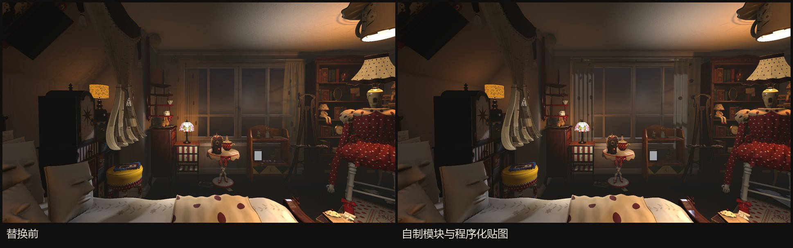
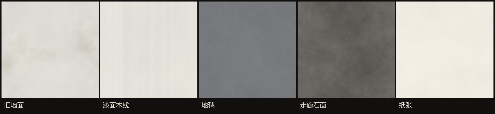

# 案例三：资产预算与程序化外壳

[文档目录](README.md) · Editor tooling / Procedural geometry / Texture generation

## 先找出成本分布

RoomAssetBudget 是只读编辑器报告工具。它遍历有效 Renderer，统计三角拓扑 submesh 的 index count / 3，记录实例数、材质槽、投影状态、LOD 覆盖、包围盒对角线与资源目录归属。输出 renderers、meshes、lights、textures 四类 CSV 和摘要。

同一 mesh 的复用与每个 renderer 的场景实例成本分开记录；否则容易把“唯一网格很少”误读成“绘制负担很小”。按三角形/米排序小物件，可优先定位近看细节需要保留、但几何密度异常高的对象。

[报告工具源码](evidence/source/RoomAssetBudget.cs)

## 2026-10-07 的资产快照

| 指标 | 当时结果 | 正确解释 |
|---|---:|---|
| 活跃渲染器 | 1,436 | 当时保存场景中的统计 |
| 网格实例三角形总量 | 7,719,407 | 不是每帧可见三角形 |
| 参与投影三角形 | 7,472,569，约 97% | 投影资格，不等于每帧全部绘制 |
| 0.5 m 以下物件所占面数 | 约 55% | 尺寸采用包围盒对角线 |
| 前 100 个渲染器面数占比 | 约 59% | 用于安排优化优先级 |
| 有 LODGroup 覆盖的面数 | 34,095 | 不能据此声称自制资产均有 LOD |
| 8 盏局部投影灯几何估算 | 约 2,590 万面 | 每灯范围按一遍统计，点光可能有更多面 |
| 材质引用贴图 | 305 张 | 资源统计，不是每帧采样数 |

例如 0.11 m 的纸条包含 57,966 面，0.18 m 的铁罐标签包含 77,968 面。这些是具体减面候选，但仍需确认几何是否携带文字或轮廓，不能批量简化后直接交付。

[原始摘要](evidence/asset-budget.txt) · [当时的完整结论](evidence/performance-20261007.md)

## 程序化重建外壳

RoomShellBuilder 用基础几何构造墙体、门洞、窗框、地面、天花板及若干小构件。不同构件选择 box、quad、tube 或 grid 组合；保留原场景的空间位置与接口，再替换 mesh 和材质引用。

重建不仅替换渲染网格，还同步 InteractionMeshSource、墙体几何目录与 MeshCollider。否则画面虽然正确，点击和碰撞仍可能使用旧形状。玻璃等特殊材质保留必要的透明设置。

重建记录包含 57 个构件、123 个旧 LOD 层级移除和 49 个碰撞网格重指向。这次调整将外壳的几何、材质和交互形状统一纳入构建工具，便于后续修改空间布局。

[构建工具源码](evidence/source/RoomShellBuilder.cs) · [替换记录](evidence/shell-replace.txt)

## 从周期噪声生成可平铺贴图

`generate_textures.py` 不读取输入图片。它使用固定 seed 生成随机场，在频域按半径与 beta 调整频谱，再 inverse FFT 得到周期噪声。不同频率、方向拉伸和阈值分别表现灰泥斑驳、刷痕、地毯纤维与石面磨损。

法线由高度图的邻域差分构造，`np.roll` 使边界采样循环；将法线归一化后编码为 RGB。BaseColor 与 Normal 分开导出，材质风格和表面起伏可分别调整。

这是离线制作脚本，玩家运行时加载已生成的纹理，不承担 FFT 生成成本。

[贴图生成脚本](evidence/source/generate_textures.py)

## 为什么没有直接采用自动 LOD

自动 Mesh LOD 曾减少几何量，却破坏书脊上的几何文字。加入连通分量保护后，676 个网格中排除 341 个，减面收益只剩约 3%，没有可测 GPU 收益，因此该方案已撤回。工具仍保留用于实验，不等于功能已启用。

这个案例体现预算报告的作用：发现高面数只是开始，是否优化成功要同时看 GPU 时间、文字、轮廓与交互。详见[性能章节](PERFORMANCE.md)。

